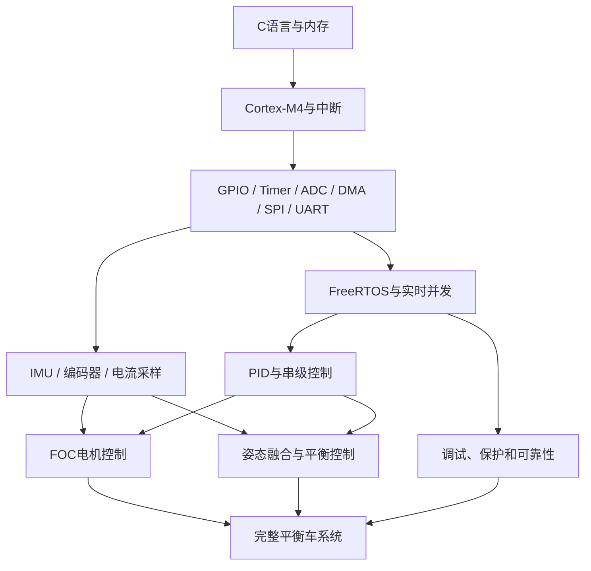
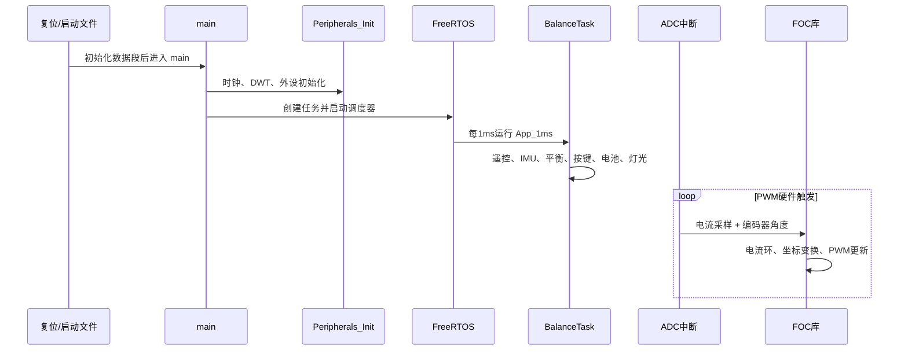

# 嵌入式控制系统工程总览

## 系统模型与模块依赖

## 按信号链组织的技术入口

| 阶段 | 内容 | 复核输出 |
|---|---|---|
| 1 | [01-C语言与嵌入式内存]({{ '/notes/c-language-memory/' | relative_url }}) | 链接、生命周期、同步机制和内存布局记录 |
| 2 | [02-Cortex-M4与中断系统]({{ '/notes/cortex-m4-interrupts/' | relative_url }}) | 向量、异常帧、嵌套和响应预算 |
| 3 | [03-AT32外设驱动与时序设计]({{ '/notes/at32-peripherals/' | relative_url }}) | 时钟、采样窗口、总线时序和错误恢复证据 |
| 4 | [04-FreeRTOS实时系统]({{ '/notes/freertos-realtime/' | relative_url }}) | 任务调度、端口配置和截止时间分析 |
| 5 | [05-实时并发与数据安全]({{ '/notes/realtime-concurrency/' | relative_url }}) | 对象所有权、同步及缓冲区生命周期 |
| 6 | [06-PID与数字控制]({{ '/notes/pid-digital-control/' | relative_url }}) | 离散增益、幅相响应和饱和恢复曲线 |
| 7 | [07-FOC无刷电机控制]({{ '/notes/foc-motor-control/' | relative_url }}) | 变换归一化、电机模型与采样更新时序 |
| 8 | [08-平衡车姿态与串级控制]({{ '/notes/balance-car-cascade-control/' | relative_url }}) | 倒立摆模型、耦合与整车扰动响应 |
| 9 | [09-传感器与数字滤波]({{ '/notes/sensors-digital-filtering/' | relative_url }}) | 标定误差、精确频响与动态延迟 |
| 10 | [10-串口-DMA与BLE协议]({{ '/notes/uart-dma-ble/' | relative_url }}) | 帧解析、DMA容量与有效命令新鲜度 |
| 11 | [11-调试故障与上板流程]({{ '/notes/debug-and-hardware-bringup/' | relative_url }}) | 故障假设、证据与回归矩阵 |
| 12 | [12-项目固件架构与验证]({{ '/notes/project-code-reading/' | relative_url }}) | 构建清单、变更依赖及系统验收记录 |

## 当前工程运行主线

对应源码：

- main.c
- app.c
- freertos_app.c
- adc.c
- Control.c

## 三条必须始终记住的边界
> **安全警告：硬实时边界**
> 本工程保留 ADC/FOC 的硬件同步中断路径。若迁移到任务执行，必须重新证明采样到 PWM 更新的最坏延迟与抖动满足截止时间；并非所有 RTOS 任务方案都不可行，但不能直接替换后沿用原实时性结论。
> **注意：中断API边界**
> NVIC优先级数值0到4的中断不能调用FreeRTOS API。允许调用 `...FromISR()` 的中断优先级必须为5到15。
> **注意：功率安全边界**
> 软件“跑起来”不等于电机可以直接落地测试。任何符号、方向、采样比例或PID错误都可能导致电机瞬间全输出。

## 工程交付应形成的四份证据

1. **接口与单位表**：每个传感器、控制量和执行量的物理单位、正方向、更新时间、有效范围以及归一化基值。
2. **实时预算表**：任务/ISR 的周期、截止时间、WCET、最长屏蔽、阻塞和释放抖动；同时记录测量覆盖范围。
3. **误差与稳定性预算**：ADC/传感器零偏、增益、温漂、量化误差，以及滤波和采样更新的总延迟。
4. **故障与恢复矩阵**：检测条件、检测时间、功率动作、数据持久化、重启策略和重新使能前置条件。

以 1 ms 控制任务为例，0.2 ms 算法耗时不代表余下 0.8 ms 全部可用；ADC 中断干扰、SPI 等待、锁阻塞和最晚 PWM 装载点共同约束实际截止时间。每项预算都需要对应可观测信号，形成“公式预测 → 仪器测量 → 参数修正”的闭环。

## 技术文档的使用边界

文中的 AT32F413 时钟、FreeRTOS 阈值、采样电阻、闭源库接口和机械参数来自原工程记录。更换芯片、库版本或硬件后，应先验证配置和接口契约。本文新增算例明确使用假设参数，不能当作当前板卡已完成的测试结果。

## 分析方法

每个知识点按下面四步巩固：

1. 不看源码，用自己的话解释概念。
2. 手写一个最小例程。
3. 在当前工程找到对应实现。
4. 修改一个参数，预测现象，再通过调试器或示波器验证。

## 系统验收检查

- [ ] 核对 PWM 触发、ADC 采样与控制计算的截止时间及实测抖动。
- [ ] 确认 RTOS tick 与高分辨率计时的时钟源、回绕和低功耗行为。
- [ ] 复核任务优先级、NVIC 分组及 FromISR 调用边界。
- [ ] 追踪遥控输入到左右 PWM 的单位、方向、限幅与所有权。
- [ ] 完成 IMU、编码器与 ADC 的标定、误差和延迟核算。
- [ ] 保存 MAP 与最大调用路径的 RAM、任务栈和 MSP 预算。
- [ ] 覆盖上电、校准、运行、故障、停机与重新使能状态转换。
